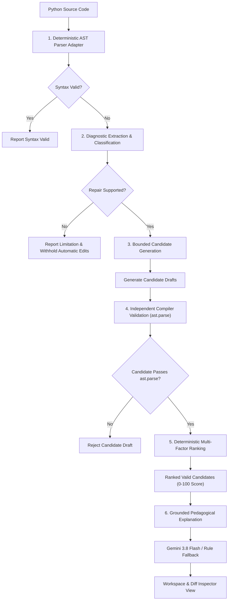

<div align="center">

# GrammarGuard AI

### **Grammar-Constrained Program Repair and Verification**

An academic Theory of Computation system and developer platform for deterministic Python syntax repair, grounded in formal grammar productions, real compiler AST validation, and pedagogical AI explanations.

---

[](https://www.typescriptlang.org/)
[](https://react.dev/)
[](https://www.python.org/)
[](https://vitejs.dev/)
[](https://tailwindcss.com/)
[](https://expressjs.com/)
[](https://microsoft.github.io/monaco-editor/)
[](https://vitest.dev/)
[](https://ai.google.dev/)

</div>

---

## Overview

Traditional LLM coding assistants generate program repairs through **unconstrained probabilistic token generation**. While effective for general synthesis, generative models frequently invent nonexistent identifiers, hallucinate syntax variants, introduce cascading syntax errors, or silently alter execution semantics.

**GrammarGuard AI** frames syntax repair as a **grammar-constrained search** over formal language productions:

- **Deterministic Parser Frontend:** Runs Python standard library `ast.parse` and `tokenize` in a zero-execution sandbox to extract exact diagnostic offsets.
- **Bounded Candidate Generation:** Generates localized candidate repairs strictly within formal delimiter, sequence separator, and expression boundary rules.
- **Hard Compiler Filtering:** Every candidate repair is re-parsed by the real Python compiler AST parser. Any draft that fails compilation is **immediately rejected**.
- **Deterministic Ranking:** Validated candidates are scored from 0 to 100 using a transparent mathematical formula based on Token Levenshtein edit distance, error proximity, and code preservation.
- **Grounded Explanations:** Explanations (via Google Gemini 3.8 Flash or deterministic rule fallback) are strictly constrained to verified compiler diagnostic facts.

> [!IMPORTANT]
> **Core Principle: Syntax Validity &ne; Semantic Correctness**  
> In formal language theory, compiler acceptance proves only that a program string belongs to the language defined by the grammar ($P \in L(G)$). Syntax acceptance **does not** prove semantic correctness, algorithmic intent, or test suite satisfaction ($P \models \text{Spec}$). GrammarGuard AI explicitly labels this boundary across all views.

---

## Table of Contents

- [Key Features](#key-features)
- [Architecture & Processing Pipeline](#architecture--processing-pipeline)
- [How the Repair Pipeline Works](#how-the-repair-pipeline-works)
- [Theory of Computation Foundations](#theory-of-computation-foundations)
- [Supported Repair Categories & Boundaries](#supported-repair-categories--boundaries)
- [Deterministic Ranking Formula](#deterministic-ranking-formula)
- [Technology Stack](#technology-stack)
- [Quick Start: How to Run the Project](#quick-start-how-to-run-the-project)
- [Installation and Setup](#installation-and-setup)
- [Configuration](#configuration)
- [Usage Example](#usage-example)
- [Testing and Evaluation](#testing-and-evaluation)
- [Application Views Overview](#application-views-overview)
- [Verification Boundaries & Limitations](#verification-boundaries--limitations)
- [Project Structure](#project-structure)
- [Roadmap & Future Improvements](#roadmap--future-improvements)
- [Contributing](#contributing)
- [License](#license)

---

## Key Features

<table>
  <tr>
    <td width="50%">
      <h3>Interactive Python Workspace</h3>
      <p>Real-time code editor powered by Monaco Editor with syntax highlighting, live AST diagnostic markers, character/token offset tracking, and instant parser feedback.</p>
    </td>
    <td width="50%">
      <h3>Deterministic Repair Engine</h3>
      <p>Generates targeted candidate repairs for missing delimiters, missing separators, and dangling operators without guessing arbitrary variables.</p>
    </td>
  </tr>
  <tr>
    <td width="50%">
      <h3>Side-by-Side Diff Inspector</h3>
      <p>Integrated Monaco Diff Editor illustrating precise token insertions and deletions with component-level score breakdowns and ranking metrics.</p>
    </td>
    <td width="50%">
      <h3>Theory of Computation Explorer</h3>
      <p>Interactive educational grammar sandbox with custom lexical tokenization, recursive-descent parse trees, leftmost step-by-step derivations, and operator precedence analysis.</p>
    </td>
  </tr>
  <tr>
    <td width="50%">
      <h3>Evaluation Lab & Benchmarks</h3>
      <p>Reproducible empirical evaluation suite with curated and synthetic test cases calculating accuracy, false-positive resistance, rejection rates, and average edit distance.</p>
    </td>
    <td width="50%">
      <h3>Privacy-First Architecture</h3>
      <p>Zero arbitrary code execution. Server-side API key isolation. Optional raw source retention in local history (defaults to SHA-256 hashes and compiler diagnostics only).</p>
    </td>
  </tr>
</table>

---

## Architecture & Processing Pipeline

GrammarGuard AI completely decouples deterministic compiler verification from optional AI explanations. Candidate repair generation and ranking operate entirely without LLM dependencies.



---

## How the Repair Pipeline Works

The system executes a deterministic 6-stage pipeline:

1. **Deterministic Syntax Analysis:**  
   The source is dispatched to a Python worker process executing `ast.parse()` and `tokenize.tokenize()`. Arbitrary user code is never run.
2. **Normalized Diagnostic Extraction:**  
   Extracts 1-indexed line numbers, column offsets, character offsets, syntax error messages, and expected tokens into a normalized diagnostic schema.
3. **Bounded Candidate Generation:**  
   Applies localized grammar production transforms:
   - `R-DELIM`: Inserts missing closing brackets/parentheses (`]`, `)`, `}`) at line boundaries and token scopes.
   - `R-SEP`: Inserts missing comma separators (`,`) between adjacent literals/expressions in collections.
   - `R-EXPR`: Trims trailing dangling binary operators (`+`, `-`, `*`, `/`) to restore valid expressions without speculative operand hallucination.
4. **Independent Hard Compiler Validation:**  
   Every generated candidate string is re-parsed independently with `ast.parse()`. Any candidate that fails compilation is **rejected immediately**.
5. **Deterministic Ranking:**  
   Valid candidates are scored on a scale of 0 to 100 using exact dynamic-programming token edit distance, spatial proximity, and preservation ratio.
6. **Fact-Grounded Explanation:**  
   The verified diagnostic payload is provided to Google Gemini 3.8 Flash to explain the formal CFG production rule violation in pedagogical terms. If the API key is absent, it seamlessly falls back to a deterministic rule-based explainer.

---

## Theory of Computation Foundations

GrammarGuard AI connects academic Theory of Computation concepts to real-world compiler engineering:

### 1. Context-Free Grammars (CFGs)
A program $P$ is syntactically valid if and only if $P \in L(G)$, where $L(G)$ is the formal language recognized by the grammar $G = (V, \Sigma, R, S)$.

### 2. Educational Teaching Grammar vs. Python Grammar
The application contains an isolated educational arithmetic grammar module (`src/grammar/teachingGrammarParser.ts`) demonstrating how non-terminals derive terminals:

$$\begin{aligned}
\text{Expression} &\to \text{Expression} + \text{Term} \mid \text{Expression} - \text{Term} \mid \text{Term} \\
\text{Term} &\to \text{Term} * \text{Factor} \mid \text{Term} / \text{Factor} \mid \text{Factor} \\
\text{Factor} &\to \text{NUMBER} \mid \text{IDENTIFIER} \mid ( \text{Expression} )
\end{aligned}$$

> **Note:** This teaching grammar is distinct from the full Python language grammar (which Python 3.10+ parses via PEG). It serves as an interactive educational playground for parse trees, derivations, and precedence hierarchies.

### 3. Parse Trees & Leftmost Derivations
- **Lexer Token Stream:** Converts input characters into typed terminal tokens (`NUMBER`, `IDENTIFIER`, `PLUS`, etc.).
- **Recursive-Descent CST:** Builds hierarchical concrete syntax tree nodes.
- **Leftmost Derivation:** Demonstrates step-by-step substitution of the leftmost non-terminal variable until only terminals remain.

---

## Supported Repair Categories & Boundaries

| Category | Typical Error Pattern | Applied Rule | Repair Strategy |
|---|---|---|---|
| **Missing Delimiter** | `'(' was never closed`, unclosed `[` or `{` | `R-DELIM` | Balances scope by inserting matching delimiter at line or token boundary |
| **Missing Separator** | Adjacent literals `[1, 2 3, 4]` | `R-SEP` | Inserts comma `,` token between consecutive literals in list/tuple/dict |
| **Incomplete Expression** | Dangling binary operator `total = price +` | `R-EXPR` | Trims trailing dangling operator to restore grammatical sentence |
| **Unsupported Scope** | `IndentationError`, cascading mismatches | *Withheld* | Automatic repair is withheld to prevent unconstrained hallucination |

---

## Deterministic Ranking Formula

Eligible candidate repairs that pass independent compiler validation are ranked using a multi-factor score between **0 and 100**:

$$\text{Score} = \text{EditMinimality}\,(45\%) + \text{LocationProximity}\,(25\%) + \text{PreservationRatio}\,(20\%) - \text{AmbiguityPenalty}\,(10\%)$$

```
┌───────────────────────────────────────────────────────────────────────────┐
│ 1. Edit Minimality (45%)                                                 │
│    Token Levenshtein distance computed via dynamic programming:           │
│    Score = max(0, 45 - (TokenDistance - 1) * 10)                          │
├───────────────────────────────────────────────────────────────────────────┤
│ 2. Location Proximity (25%)                                               │
│    Proximity of edit character offset to compiler error location:         │
│    Score = max(0, 25 - (CharOffsetDelta / 20) * 5)                        │
├───────────────────────────────────────────────────────────────────────────┤
│ 3. Preservation Ratio (20%)                                               │
│    Percentage of original tokens and lines retained unmodified:           │
│    Score = (UnchangedOriginalLines / TotalOriginalLines) * 20              │
├───────────────────────────────────────────────────────────────────────────┤
│ 4. Ambiguity Penalty (10%)                                                │
│    Deducted when multiple distinct valid candidate interpretations exist: │
│    Penalty = 10 if ValidCandidatesCount > 1 else 0                        │
└───────────────────────────────────────────────────────────────────────────┘
```

---

## Technology Stack

### Frontend
- **Core Framework:** [React 19](https://react.dev/) + [TypeScript 5.x](https://www.typescriptlang.org/)
- **Build Tooling:** [Vite 6](https://vitejs.dev/)
- **Styling:** [Tailwind CSS 4](https://tailwindcss.com/)
- **Code Editor:** [Monaco Editor](https://microsoft.github.io/monaco-editor/) + Monaco Diff Editor (`@monaco-editor/react`)
- **Data Visualization:** [Recharts](https://recharts.org/)
- **Icons & UI:** [Lucide React](https://lucide.dev/), [Motion](https://motion.dev/)

### Backend & Compiler Pipeline
- **Runtime:** [Node.js](https://nodejs.org/) + [Express 4](https://expressjs.com/)
- **TypeScript Runner:** [tsx](https://github.com/privatenumber/tsx)
- **Parser Engine:** [Python 3.10+](https://www.python.org/) standard library (`ast.parse`, `tokenize.tokenize`, `compile`)
- **AI Explanation Service:** [Google GenAI SDK](https://github.com/google-gemini/deprecations) (`@google/genai` with Gemini 3.8 Flash)
- **Unit Testing:** [Vitest](https://vitest.dev/)

---

## Quick Start: How to Run the Project

Run these 3 commands in your terminal (PowerShell, Command Prompt, or Bash) to get GrammarGuard up and running immediately:

```bash
# Step 1: Install all project dependencies
npm install --legacy-peer-deps

# Step 2: Build client assets with Vite
npm run build

# Step 3: Start the full-stack server (Express backend + Python parser + Vite frontend)
npm run dev
```

Once started, navigate to **`http://localhost:3000`** in your browser.

---

## Installation and Setup

### Prerequisites
- **Node.js:** `>= 18.0.0` (Tested on Node v20 / v24)
- **Python:** `>= 3.10.0` (Must be available in system `PATH` as `python` or `python3`)
- **Package Manager:** `npm`

### Step-by-Step Instructions

#### 1. Clone Repository
```bash
git clone https://github.com/hackChinmay/GrammerGuard.git
cd GrammerGuard
```

#### 2. Install Dependencies
```bash
npm install --legacy-peer-deps
```

#### 3. Build Client Bundle
```bash
npm run build
```

#### 4. Configure Environment (Optional)
Create a `.env` file from `.env.example`:
```bash
cp .env.example .env
```
*(Optional: Set `GEMINI_API_KEY` for AI explanations. If omitted, the deterministic rule-based explainer activates automatically).*

#### 5. Launch Application
```bash
npm run dev
```
The application will be live at: **`http://localhost:3000`** (Express backend + Vite client + Python parser worker).

#### Production Run (Optional)
```bash
npm run build
npm start
```

---

## Configuration

GrammarGuard AI uses server-side environment variables loaded exclusively on the Express backend:

| Variable | Required | Default | Description |
|---|---|---|---|
| `GEMINI_API_KEY` | Optional | `""` | Google Gemini API key for pedagogical explanations. Falls back to rule-based engine if omitted. |
| `PORT` | Optional | `3000` | Port for the Express backend & dev server. |
| `NODE_ENV` | Optional | `development` | Environment mode (`development` or `production`). |

---

## Usage Example

### 1. Input Code (Syntax Error)
```python
total = (price + tax
```

### 2. Compiler Diagnostic
```json
{
  "parseSuccess": false,
  "category": "missing_delimiter",
  "line": 1,
  "column": 9,
  "message": "'(' was never closed",
  "expectedTokens": [")"],
  "automaticRepairEligible": true
}
```

### 3. Generated Candidates & Independent Validation
- **Candidate 1:** `total = (price + tax)` &rarr; `ast.parse` **PASSED** (Syntax Valid)
- **Candidate 2:** `total = (price + tax]` &rarr; `ast.parse` **REJECTED** (SyntaxError)

### 4. Deterministic Scoring Output
- **Token Edit Distance:** 1 edit (`INSERT ')'`)
- **Diagnostic Proximity:** Offset matches error location ($25/25$)
- **Preservation Ratio:** $100\%$ original tokens preserved ($20/20$)
- **Total Score:** $90.0 / 100$

---

## Testing and Evaluation

### Automated Unit Test Suite
GrammarGuard AI includes automated test coverage with **Vitest** testing the Python parser adapter, candidate repair generation, delimiter repairs, separator insertions, incomplete expressions, and the teaching grammar parser:

```bash
# Run unit tests
npm test

# Run TypeScript type check
npm run lint
```

### Evaluation Lab & Benchmark Suite
The backend includes a reproducible benchmark runner (`backend/evaluation/benchmarkSuite.ts`) that executes empirical evaluations across curated canonical syntax errors, synthetic cases, and negative controls.

The suite calculates:
- **Repair Success Rate (%):** Percentage of eligible cases where the top-ranked repair matches the intended syntax repair.
- **False-Positive Resistance (%):** Percentage of valid Python inputs correctly left unedited (0% modifications on valid programs).
- **Candidate Rejection Rate (%):** Percentage of generated candidate drafts rejected by `ast.parse`.
- **Candidate Syntax-Validation Rate (%):** Percentage of generated candidate drafts passing independent compilation.
- **Average Token Edit Cost:** Mean token-level Levenshtein distance across valid repairs.
- **Top-1 Usefulness (%):** Accuracy of the rank #1 candidate matching the intended repair.

You can trigger and visualize benchmark metrics directly from the **Evaluation Lab** view in the UI or via `POST /api/evaluate`.

---

## Application Views Overview

- **Code Workspace (`/workspace`):** Full Monaco code editor with real-time parser execution, diagnostic badge inspector, side-by-side diff modal, and one-click fix application.
- **Grammar Explorer (`/grammar`):** Interactive Theory of Computation laboratory with live AST parse trees, leftmost derivations, token tables, and grammar rule explanations.
- **Evaluation Lab (`/evaluation`):** Empirical benchmark suite dashboard with Recharts visualizations, category success breakdowns, and individual case results.
- **Analysis History (`/history`):** Session history with JSON export, cryptographic hash auditing, and session restoration.
- **Settings & Environment (`/settings`):** Privacy mode toggles, candidate search space bounds (1 to 10), and explainer configuration.

---

## Verification Boundaries & Limitations

1. **Syntax vs. Semantics:**  
   Passing compiler validation proves grammatical membership ($P \in L(G)$); it does not prove algorithmic correctness or execution satisfaction ($P \models \text{Spec}$).
2. **Localized Error Scope:**  
   Candidate generation is bounded to single-site delimiter balance, missing separators, and dangling operators. High-entropy syntax mismatches (e.g., arbitrarily scrambled block indentation) are withheld.
3. **Zero Dynamic Execution:**  
   The platform intentionally does not execute user code at runtime. Verification is strictly static AST analysis.

---

## Project Structure

```
grammarguard/
├── backend/                        # Express backend & Python parser adapter
│   ├── evaluation/
│   │   └── benchmarkSuite.ts       # Benchmark dataset & empirical metrics runner
│   ├── gemini/
│   │   └── geminiService.ts        # Gemini 3.8 Flash explainer with rule fallback
│   ├── parser/
│   │   ├── pythonParser.ts         # TypeScript child-process bridge
│   │   └── python_parser_worker.py # Zero-execution Python AST worker
│   └── repair/
│       └── repairEngine.ts         # Bounded repair generation & ranking formula
├── src/                            # React 19 Frontend
│   ├── components/                 # UI views & editor components
│   │   ├── CandidateCard.tsx       # Ranked candidate card with score breakdown
│   │   ├── CandidateRepairsList.tsx# Candidate list & ineligibility guard
│   │   ├── DiffModal.tsx           # Side-by-side Monaco diff viewer
│   │   ├── ErrorInspector.tsx      # Compiler diagnostic panel
│   │   ├── EvaluationLabView.tsx   # Benchmark dashboard with Recharts
│   │   ├── GrammarExplorerView.tsx # Theory of computation interactive CFG explorer
│   │   ├── Header.tsx              # Top navigation bar
│   │   ├── HelpModal.tsx           # Theory & documentation modal
│   │   ├── HistoryView.tsx         # Privacy-aware analysis history
│   │   ├── OverviewView.tsx        # Dashboard & system overview
│   │   ├── PythonEditor.tsx        # Monaco code editor wrapper
│   │   ├── SettingsView.tsx        # Environment & privacy configuration
│   │   ├── Sidebar.tsx             # Navigation sidebar
│   │   └── WorkspaceView.tsx       # Main code repair workspace
│   ├── grammar/
│   │   └── teachingGrammarParser.ts# Teaching CFG parser, lexer, & derivations
│   ├── services/
│   │   ├── apiClient.ts            # Frontend REST client for /api endpoints
│   │   └── storageService.ts       # LocalStorage abstraction with privacy mode
│   ├── types/
│   │   └── grammarGuard.ts         # TypeScript domain models and interfaces
│   ├── App.tsx                     # Main application container
│   ├── index.css                   # Tailwind CSS styling
│   └── main.tsx                    # React application entry point
├── tests/
│   └── parserAndRepair.test.ts     # Vitest suite for parser, repair, & grammar
├── .env.example                    # Environment variables template
├── .gitignore                      # Git ignore rules
├── index.html                      # Single-page application entry point
├── metadata.json                   # Project metadata
├── package.json                    # Project dependencies & scripts
├── server.ts                       # Express full-stack development & API server
├── tsconfig.json                   # TypeScript configuration
└── vite.config.ts                  # Vite build configuration
```

---

## Roadmap & Future Improvements

- [ ] **Multi-line Block Scope Balancing:** Support for multi-line block delimiter repairs (`try/except`, `with`, unclosed triple-quoted docstrings).
- [ ] **Extended Language Frontends:** Formal grammar adapters for JavaScript/TypeScript (via Babel/SWC) and Rust.
- [ ] **Automated Test-Suite Integration:** Optional sandboxed test runner execution (e.g., `pytest` / `unittest`) for semantic validation when opted-in.
- [ ] **PEG Grammar Visualizer:** Interactive PEG (Parsing Expression Grammar) packrat derivation explorer for Python 3.10+ PEG specifications.

---

## Contributing

Contributions, bug reports, and academic discussions on grammar-constrained program repair are welcome!

1. Fork the repository (`https://github.com/hackChinmay/GrammerGuard`).
2. Create your feature branch (`git checkout -b feature/grammar-enhancement`).
3. Commit your changes (`git commit -m 'feat: add support for dictionary comprehension delimiters'`).
4. Push to the branch (`git push origin feature/grammar-enhancement`).
5. Open a Pull Request.

---

## License

This project is currently distributed for academic and developer research purposes. A formal open-source license has not yet been specified.

---

<div align="center">
  <sub>Built with ❤️ for Theory of Computation, Compiler Engineering, and Deterministic Program Repair.</sub>
</div>
